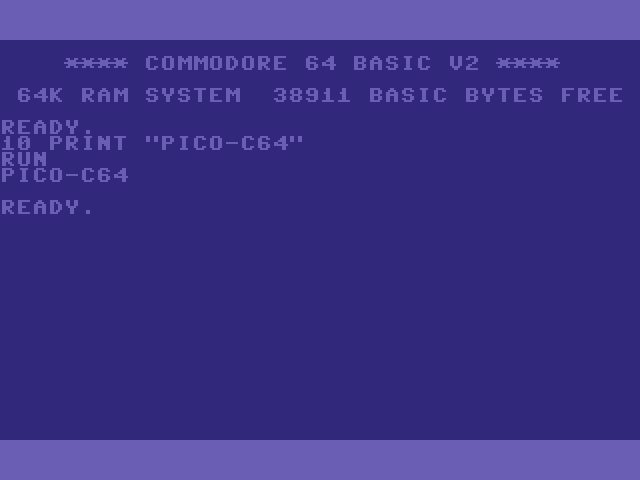
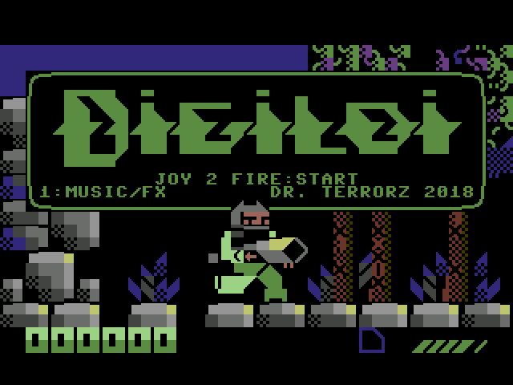
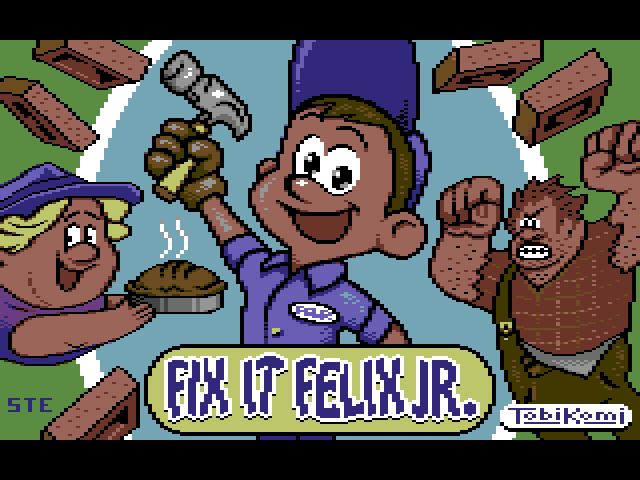
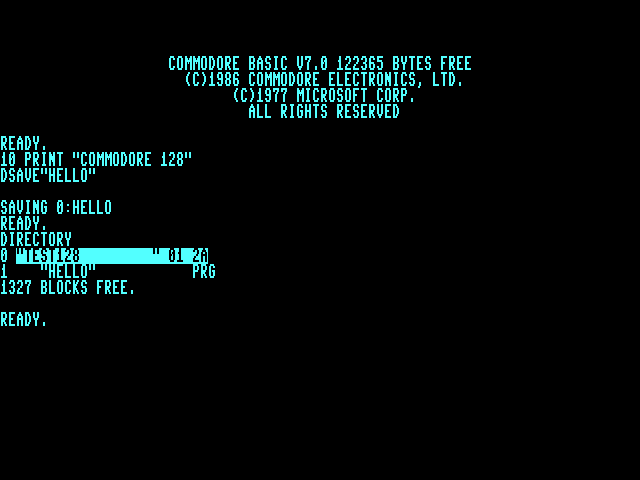
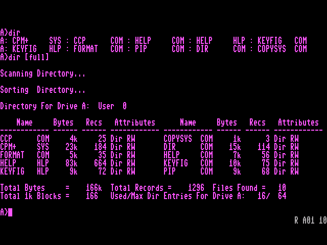
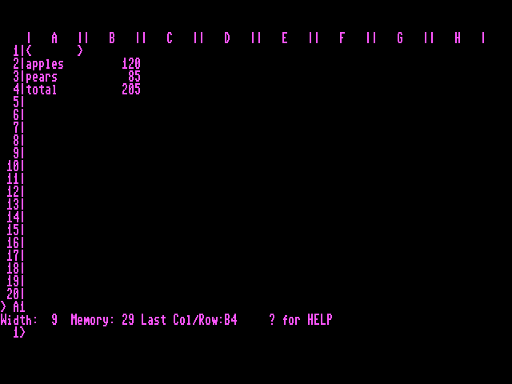

# pico-c64

A Commodore 64 and Commodore 128 emulator for the Raspberry Pi Pico 2 (RP2350). It runs
programs, disk images, tapes and cartridges from an SD card and puts the picture and sound
on a TV or monitor over HDMI or DVI. A USB keyboard works as the computer's keyboard and
game controllers as its joysticks.

Ported by Frank Hoedemakers ([fhoedemakers](https://github.com/fhoedemakers)), with AI
assistance (see [AI assistance](#ai-assistance)).

Based on the emulation core of [esp32cbm](https://github.com/rlucencic/esp32cbm) by Robert
Lucencic, with the 6502 and Z80 cores from [esp32emu](https://github.com/rlucencic/esp32emu),
and on the video, audio, menu and SD card framework of
[pico-infonesPlus](https://github.com/PicoPlus-devel/pico-infonesPlus).

> [!IMPORTANT]
> RP2350 only. The RP2040 is not fast enough: the 6510 and the 1541 drive are emulated
> cycle by cycle.

| | | |
|:--:|:--:|:--:|
|  |  |  |
| C64 BASIC | *Digiloi* (Dr. TerrorZ, 2018), a cartridge | *Fix-it Felix Jr.*, a program |
|  |  |  |
| C128 BASIC 7.0 in 80 columns, with a 1571 disk | CP/M 3.0 on the C128 | *SuperCalc 2* under CP/M |

<sub>The pictures as the board puts them out (640 × 480), made by the emulation core on a
PC with the [test harness](#test-harness).</sub>

## Features

**Commodore 64**
- A PAL Commodore 64: the 6510 cycle by cycle, including its undocumented instructions;
  the VIC-II with bad lines and sprite DMA; two 6526 CIAs; the SID (6581).
- Programs (`.prg`, `.t64`) start straight from the menu, and the `C64 BASIC` entry starts
  BASIC with nothing loaded. See [Starting a program](#starting-a-program).
- Disk drive 8, a 1541-II with its own 6502 running the drive's DOS, so fast loaders work.
  `.d64` and `.g64` images, read and write. **Fast disk load** loads programs at once.
  Disks can be changed and blank disks created from the settings menu. See [Disks](#disks).
- A datasette with `.tap` images, including turbo loaders, and recording to tape. See
  [Tape](#tape).
- Cartridges (`.crt`), including Ocean, EasyFlash and Magic Desk. See
  [Cartridges](#cartridges).

**Commodore 128**, on boards with HSTX video and PSRAM
- BASIC 7.0 on the 40- and 80-column screens, 2 MHz mode, C64 mode, the Z80 with CP/M 3.0,
  and a 1571 drive with `.d71` images. See [Commodore 128](#commodore-128).

**Keyboard and controllers**
- A USB keyboard, in a US layout or the C64's own, with the C128's extra keys. See
  [Keyboard](#keyboard).
- Two joystick ports from USB controllers, NES and SNES controllers on the GPIO port, Wii
  Classic controllers or the numeric keypad. See [Controllers](#controllers).
- Text sent to the board's serial console is typed into the computer, such as a BASIC
  listing pasted from a PC. See [Serial keyboard](#serial-keyboard).

**Menu**
- The rom browser of the emulator family, with folders, a list of recently played games and
  a USB drive mode, and a settings menu that can also be opened while a game runs. See
  [Menu](#menu).

**Other**
- Runs with or without PSRAM. Without it, the ROMs are kept in the board's flash. See
  [PSRAM](#psram).
- A [test harness](#test-harness) that runs the emulation core on Linux, for developers.

See [Known issues](#known-issues) and [Not yet done](#not-yet-done) for what is missing.

## Getting started

1. **Flash the firmware.** Pick the `.uf2` for your board from the
   [supported boards](#supported-boards) table and download it from the
   [releases page](https://github.com/PicoPlus-devel/pico-c64/releases/latest). Hold the
   BOOTSEL button while you connect the board to your computer, then copy the file to the
   drive that appears.
2. **Prepare an SD card** formatted as FAT32 (recommended) or exFAT.
3. **Copy the ROM files** to `/roms/C64/bios` on the card. They are not distributed with
   the emulator, and nothing runs without them. See [ROM files](#rom-files).
4. **Copy programs, disk images, tapes and cartridges** to `/roms/C64`. Subdirectories are
   supported.
5. **Insert the card**, switch the board on and pick a file from the menu.

### ROM files

The ROMs are read from the first of these folders that has them: `/roms/C64/bios`,
`/bios/c64`, `/bios`, `/roms/bios`.

| ROM | File names accepted | Size |
|:--|:--|:--|
| BASIC V2 (901226-01) | `c64basic.rom`, `basic`, `basic.901226-01.bin` | 8 KB |
| KERNAL (901227-03) | `c64kernal.rom`, `kernal`, `kernal.901227-03.bin` | 8 KB |
| Character set (901225-01) | `c64chargen.rom`, `chargen`, `characters.901225-01.bin` | 4 KB |
| 1541-II DOS (251968-03) | `1541.rom`, `dos1541`, `1541-II.251968-03.bin` | 16 KB |

The first three are required. Without the 1541 ROM there is no disk drive; programs,
tapes and cartridges still work.

The Commodore 128 needs its own ROMs, in the same folders:

| ROM | File names accepted | Size |
|:--|:--|:--|
| BASIC 7.0, low and high (318022-02) | `c128basic.rom`, `basic.318022-02.bin` | 32 KB |
| KERNAL (318020-05) | `c128kernal.rom`, `kernal.318020-05.bin` | 16 KB |
| Character set (390059-01) | `c128chargen.rom`, `characters.390059-01.bin` | 8 KB |
| C64 mode (251913-01) | `c128c64.rom`, `64c.251913-01.bin` | 16 KB |
| 1571 DOS (310654-05) | `1571.rom`, `dos1571`, `1571-rom.310654-05.bin` | 32 KB |

The first four are required for the C128; without the 1571 ROM it has no disk drive.

## Supported boards

Everything runs on the RP2350 (Pico 2) with the Arm cores. RP2040 boards and RISC-V builds
are not supported.

The boards are the same as for the other emulators of the family. The board name links to
the setup section of the [pico-infonesPlus readme](https://github.com/PicoPlus-devel/pico-infonesPlus#setup),
with the parts needed, the wiring and how to flash the board. Ready-made `.uf2` files are on
the [releases page](https://github.com/PicoPlus-devel/pico-c64/releases/latest).

| Board | Video output | PSRAM | Commodore 128 | Build command | Release binary |
| ----- | ------------ | ----- | ------------- | ------------- | -------------- |
| [Adafruit Fruit Jam](https://github.com/PicoPlus-devel/pico-infonesPlus#adafruit-fruit-jam) | HSTX | 8 MB | Yes | `./bld.sh -c 8` | `picoC64_AdafruitFruitJam_arm_piousb.uf2` |
| [Pico 2 or Pimoroni Pico Plus 2 with an Adafruit DVI breakout and microSD breakout](https://github.com/PicoPlus-devel/pico-infonesPlus#raspberry-pi-pico-or-pico-2-setup-with-adafruit-hardware-and-breadboard), on a breadboard or on the [PicoNES PCB](#custom-pcbs) | HSTX | Pico Plus 2: 8 MB | With a Pico Plus 2 | `./bld.sh -c 2 -2` | `picoC64_AdafruitDVISD_pico2_arm.uf2` |
| [Adafruit Metro RP2350](https://github.com/PicoPlus-devel/pico-infonesPlus#adafruit-metro-rp2350) — *untested* | HSTX | Optional | With PSRAM | `./bld.sh -c 5` | `picoC64_AdafruitMetroRP2350_arm.uf2` |
| [Adafruit Feather RP2350](https://www.adafruit.com/product/6000) with a TLV320DAC3100 DAC and a microSD breakout — *untested* | HSTX | Optional | With PSRAM | `./bld.sh -c 14` | `picoC64_AdafruitFeatherRP2350_TLV320DAC3100_arm_piousb.uf2` |
| [Murmulator M2](https://murmulator.ru/) — *untested* | HSTX | Yes | Yes | `./bld.sh -c 13` | `picoC64_MurmulatorM2_arm.uf2` |
| [Olimex RP2040-PICO-PC](https://github.com/PicoPlus-devel/pico-infonesPlus#olimex-rp2040-pico-pc) with a Pico 2 — *untested* | HSTX | Optional | With PSRAM | `./bld.sh -c 15` | `picoC64_OlimexPicoPC_arm.uf2` |
| [Pimoroni Pico DV Demo Base](https://github.com/PicoPlus-devel/pico-infonesPlus#raspberry-pi-pico-or-pico-2-setup-for-pimoroni-pico-dv-demo-base) with a Pico 2 or Pico Plus 2 — *untested* | PicoDVI | Pico Plus 2: 8 MB | No | `./bld.sh -c 1 -2` | `picoC64_PimoroniDVI_pico2_arm.uf2` |
| [Waveshare RP2350-Zero on the PicoNES Mini PCB](https://github.com/PicoPlus-devel/pico-infonesPlus#pcb-with-waveshare-rp2040rp2350-zero) — *untested* | PicoDVI | None | No | `./bld.sh -c 6 -2` | `picoC64_WaveShareRP2350ZeroWithPCB_arm.uf2` |
| [Waveshare RP2350-PiZero](https://github.com/PicoPlus-devel/pico-infonesPlus#waveshare-rp2040rp2350-pizero-development-board) — *untested* | PicoDVI | Optional | No | `./bld.sh -c 7` | `picoC64_WaveShareRP2350PiZero_arm_piousb.uf2` |
| [Waveshare RP2350-USB-A](https://github.com/PicoPlus-devel/pico-infonesPlus#pcb-with-waveshare-rp2350-usb-a), on its own or on the PicoNES Micro PCB — *untested* | PicoDVI | None | No | `./bld.sh -c 9` | `picoC64_WaveShare2350USBA_arm_piousb.uf2` |
| [Spotpear HDMI board](https://spotpear.com/index/product/detail/id/1207.html) — *untested* | PicoDVI | None | No | `./bld.sh -c 10 -2` | `picoC64_SpotpearHDMI_pico2_arm.uf2` |
| [Murmulator M1](https://murmulator.ru/) — *untested* | PicoDVI | Yes | No | `./bld.sh -c 12 -2` | `picoC64_MurmulatorM1_pico2_arm.uf2` |

Boards marked *untested* build and are released, but have not been tried on real hardware.
The Adafruit Feather RP2350, Spotpear and Murmulator boards have no setup section in the
pico-infonesPlus readme: wire them according to their own documentation.

- **Video and clock.** Boards with HSTX video run the RP2350 at 384 MHz, boards that use
  the PicoDVI driver at 252 MHz. Both put out 60 Hz. There is no Overclock setting.
- **Commodore 128.** It needs HSTX video for its 80 columns and PSRAM for its second 64 KB
  of RAM and its larger ROMs. On other boards the C128 entries and `.d71` files are not
  offered.

### PSRAM

PSRAM is optional for the C64. With PSRAM, a cartridge starts as soon as it is picked and a
disk is held in memory as a whole. Without PSRAM:

- The ROM files are copied from the SD card to the last 64 KB of the flash at the first
  start, which takes a few seconds, and are read from there. This happens again only when
  the files on the card change, or when other software has overwritten that part of the
  flash.
- A cartridge is written to flash before it starts, and the board restarts once.
- Disks are read through a two-track cache, see [Disks](#disks).
- The disk and tape lists in the settings menu show at most 24 files.

## Custom PCBs

Four community PCB designs turn a supported board and its breakouts into a small console.
Nothing changes in the firmware: flash the binary for that configuration. The controller
ports work as the C64's two joysticks. Parts lists, ordering instructions, assembly notes,
the 3D-printed cases and the older design versions are described in the
[PCB README](https://github.com/PicoPlus-devel/pico_shared/blob/main/PCB/README.md), and
the setup sections in the
[pico-infonesPlus readme](https://github.com/PicoPlus-devel/pico-infonesPlus#custom-pcbs).

| Design | Picture | Controller ports | Board it carries | Build | Designed by |
| --- | --- | --- | --- | --- | --- |
| [PicoNES v2.6](https://github.com/PicoPlus-devel/pico-infonesPlus#pcb-with-raspberry-pi-pico-or-pico-2-and-pimoroni-pico-plus-2) |  | 2 × NES | Pico 2, Pico 2 W or Pimoroni Pico Plus 2 | `-c 2 -2` | [John Edgar Park](https://twitter.com/johnedgarpark) |
| [PicoNES v2.8](https://github.com/PicoPlus-devel/pico-infonesPlus#pcb-with-raspberry-pi-pico-or-pico-2-and-pimoroni-pico-plus-2) |  | 2 × SNES | Pico 2, Pico 2 W or Pimoroni Pico Plus 2 | `-c 2 -2` | [John Edgar Park](https://twitter.com/johnedgarpark) |
| [PicoNES Mini](https://github.com/PicoPlus-devel/pico-infonesPlus#pcb-with-waveshare-rp2040rp2350-zero) |  | 2 × NES | Waveshare RP2350-Zero | `-c 6 -2` | [Gavin Knight](https://github.com/DynaMight1124) |
| [PicoNES Micro](https://github.com/PicoPlus-devel/pico-infonesPlus#pcb-with-waveshare-rp2350-usb-a) |  | None, USB controller only | Waveshare RP2350-USB-A | `-c 9` | [Gavin Knight](https://github.com/DynaMight1124) |

> [!NOTE]
> The PicoNES v2.6 and v2.8 are shown with a Pimoroni Pico Plus 2. A Raspberry Pi Pico 2 or
> Pico 2 W can also be fitted. With a Pimoroni Pico Plus 2, which has PSRAM, the PicoNES
> also runs the Commodore 128.

> [!NOTE]
> Sellers on AliExpress have copied the PicoNES design and sell ready-made boards. For
> questions about those, contact the seller.

## Starting a program

The menu lists these files:

| Extension | What happens |
|:--|:--|
| `.prg`, `.t64` | The program is loaded into memory and started with `RUN`. |
| `.d64`, `.g64` | The disk goes into drive 8; `LOAD"*",8,1` is typed, then `RUN` once the C64 is back at `READY`. With **Machine** set to C128, the disk starts on a C128 instead. |
| `.d71` | The disk goes into the C128's drive 8, see [Commodore 128](#commodore-128). |
| `.tap` | The tape goes into the datasette with PLAY down; `LOAD` is typed, then `RUN` once the C64 is back at `READY`. |
| `.crt` | The cartridge is inserted and the C64 starts with it. |
| `.c64` | The C64 starts with nothing loaded, at the BASIC prompt. See below. |
| `.c128` | The C128 starts with nothing loaded, at the BASIC 7.0 prompt. |

**BASIC.** The menu is built around picking a file, but plain BASIC needs none. The file
`C64 BASIC.c64` is created in `/roms/C64` at start-up when that folder exists; selecting it
starts the C64 at `READY`. On boards that can run the C128, `C128 BASIC.c128` is created
there too. Their content is not used.

## Disks

Drive 8 is a 1541-II. Disk images are read and written: what the C64 saves is written back
to the image file on the SD card when the drive stops, when the settings menu is opened and
when the game is quit.

**Fast disk load** (settings menu, on by default) reads a `LOAD` from drive 8 straight out
of the disk image, instead of at the 1541's speed of about 400 bytes a second. It applies
only to the C64's own LOAD routine: a directory (`LOAD"$",8`), a file that is not on the
disk, and every program that loads with a loader of its own go to the emulated drive as
before. Switch it off for software that needs the drive's exact behaviour.

**Changing disks.** The **Drive 8** row of the settings menu, opened during a game, lists
the `.d64` and `.g64` files in the folder the game was started from, which is where a
multi-disk game keeps its other disks. When the folder holds more than the list can show,
the names closest to the game's are listed. `<no disk>` ejects the disk.

**Creating a blank disk.** In the same list, **Create blank disk** asks for a name (with a
USB keyboard; without one, the name shown is used), creates `<name>.d64` in that folder,
formats it with that name and puts it into drive 8.

With PSRAM the whole disk is held in memory. Without PSRAM, two tracks at a time are, read
from the SD card as the drive's head reaches them.

## Tape

The datasette plays `.tap` images (versions 0 and 1). Each pulse reaches the C64 at its
exact cycle, so the KERNAL's loader and turbo loaders work. A tape loads at the speed of a
real datasette.

The **Cassette** row of the settings menu, opened during a game, offers:

- `<no tape>`: ejects the tape.
- **Record (TAP)**: asks for a name and records what the C64 saves into a new
  `<name>.tap`, with RECORD and PLAY down.
- **Rewind**, while a tape is in.
- The `.tap` files in the folder the game was started from: the tape goes in with PLAY down.

When the C64 shows `PRESS PLAY ON TAPE` or `PRESS RECORD & PLAY ON TAPE` and there is no
tape in the datasette, the tape list or the name prompt for a recording opens by itself.

**Reset game** in the settings menu also rewinds the tape a game was started from, so the
`LOAD` typed after the reset starts from the beginning. Rewinding while a turbo loader is
running does not restart that loader, as on a real C64; reset instead.

## Cartridges

Supported `.crt` types: normal 8 KB, 16 KB and Ultimax cartridges, Ocean, Fun Play, Super
Games, System 3, Dinamic, Magic Desk, Simons' BASIC and EasyFlash (read only). The
cartridge is read in place from where the menu loaded it, in flash or in PSRAM.

## Commodore 128

The C128 runs on boards with HSTX video and PSRAM, see [Supported boards](#supported-boards).

It starts from `C128 BASIC.c128`, from a `.d71` disk, or from a `.d64` or `.g64` disk when
**Machine** in the settings menu is set to C128. A disk that starts itself (a boot sector,
as on the CP/M system disk) is left to the C128; otherwise `RUN"*"` is typed once the C128
is at `READY`. Programs (`.prg`, `.t64`), tapes and cartridges always start on a C64.

**80 columns.** The C128 has two screens. **40/80 DISPLAY** (F11 or Print Screen) switches
the picture between the 40-column screen and the 80-column screen; it locks, as on the
C128, which reads it at start-up to choose the screen BASIC uses. `ESC` `X` (F9, then X)
moves BASIC to the other screen.

**2 MHz.** BASIC 7.0's `FAST` switches the 40-column screen off, as on a real C128, and
`SLOW` switches it back on. The 80-column screen keeps working at 2 MHz.

**C64 mode.** `GO64` switches to C64 mode, with the C64's BASIC and KERNAL.

**CP/M.** With the C128 CP/M system disk in drive 8, the C128 starts CP/M 3.0 on its Z80.
CP/M chooses its screen when it starts: for 80 columns, press F11 (40/80 DISPLAY) before
or while CP/M loads.

**Disks.** Drive 8 is a 1571. It reads `.d64`, `.g64` and double-sided `.d71` images, and
**Create blank disk** creates a `.d71`. Fast disk load applies to the C64 only; the 1571
loads in burst mode, which is faster than a 1541.

## Keyboard

A USB keyboard is the C64 keyboard. **Keyboard layout** in the settings menu selects how
keys are mapped.

**US** (default): a key types what is printed on it.

| PC key | C64 |
|:--|:--|
| Shift+2 | `@` |
| Shift+6 | `↑` |
| Shift+7, Shift+8 | `&`, `*` |
| `'`, Shift+`'` | `'`, `"` |
| `[`, `]` | `[`, `]` |
| `\` | `£` |
| Shift+`-` | `←` |
| Left Ctrl | CTRL |
| Left Alt | Commodore key |
| Insert | INST |
| Delete, Backspace | DEL |

`{`, `}`, `|` and `~` have no key on the C64 and do nothing.

**C64**: a key does what the C64 key in the same position does, for software that uses keys
by position. Tab is CTRL, Left Ctrl and Left Alt the Commodore key, Insert `£`, End `=`,
`` ` `` `←` and `\` `↑`.

**Both layouts:**

| PC key | C64 |
|:--|:--|
| Esc | RUN/STOP |
| Page Up | RESTORE |
| Home | CLR/HOME |
| Caps Lock | SHIFT LOCK |
| F1, F3, F5, F7 | F1, F3, F5, F7 |
| F2, F4, F6, F8 | SHIFT + F1, F3, F5, F7 |
| Cursor keys | CRSR keys (left and up with SHIFT) |
| Numeric keypad | Joystick: 8 4 6 2 and the diagonals, 0 or 5 fire (Right Ctrl fires too) |
| F12 | Settings menu |

**Commodore 128 keys:**

| PC key | C128 |
|:--|:--|
| F9 | ESC |
| F10 | HELP |
| F11, Print Screen | 40/80 DISPLAY |
| Right Alt | ALT |
| End | LINE FEED (US layout) |
| Scroll Lock | NO SCROLL |
| Caps Lock | CAPS LOCK in C128 mode, SHIFT LOCK in C64 mode |

The C128's separate cursor keys and numeric keypad are not mapped: the cursor keys work as
on the C64, and the numeric keypad remains a joystick.

## Controllers

Game controllers are joysticks. The first is in port 2, where most games read it, and the
second in port 1. USB controllers, NES and SNES controllers on the GPIO port of a PCB or
breadboard setup, and Wii Classic controllers on boards with a port for them, such as the
Fruit Jam, can be used.

| Button | Function |
|:--|:--|
| D-pad | Joystick |
| A | Fire |
| B | SPACE |
| X | RETURN |
| Y | F1 |
| START (pressed on its own) | RUN/STOP |
| SELECT + START | Settings menu |
| SELECT + A | Swap the joystick ports for this game |
| SELECT + UP / DOWN | Screen mode |
| START + A | Frame rate display |
| SELECT + START + UP + A | Reboot into BOOTSEL mode |

**Joystick port** in the settings menu selects the port of the first controller at the
start of every game.

## Serial keyboard

With **Serial keyboard** switched on in the settings menu, text sent to the board's UART
console (115200 baud) is typed into the machine: a BASIC listing pasted into a terminal
program, or commands for CP/M. Each key is held until the machine has read it, and typing
waits while BASIC's keyboard buffer is full or a disk drive is running, so nothing is lost
while a line is being processed or a program is loading. Typing runs at up to about 25
characters a second.

- Letters are typed without SHIFT, whatever their case, so a listing in capitals types as
  BASIC keywords.
- Return or Enter is RETURN; Backspace is DEL; Ctrl-A to Ctrl-Z are CTRL with that letter.
- Esc is RUN/STOP on the C64 and ESC on the C128; Tab is the C128's TAB.
- `_` is the left arrow and `\` the pound sign.
- Ctrl-] is 40/80 DISPLAY and Ctrl-^ is RESTORE.
- Ctrl-\ is not typed: it prints the text screen shown (40 or 80 columns) on the console.

The board answers XON/XOFF when its input buffer fills; enable software flow control in the
terminal program for long listings. A key pressed on the USB keyboard abandons what is
still waiting to be typed. The option is not shown on boards whose UART receive pin is
used for something else, or that have no UART console.

## Menu

The rom browser is the one all emulators of the family share.

- UP/DOWN: next/previous item; LEFT/RIGHT: next/previous page.
- SELECT: the settings menu, which can also be opened while a game runs (SELECT + START, or
  F12 on a keyboard).

The buttons that open and go back depend on the controller:

| | (S)NES | XInput | Dual Shock/Sense | Keyboard |
| --- | --- | --- | --- | --- |
| Open a folder, start the selected file, choose an option | A | B | Circle | Enter or X |
| Back to the parent folder, close, cancel | B | A | Cross | Esc or Z |
| SELECT | Select | Select | Select | A |

From the rom browser, the settings menu also offers **Recently played**, the last games
started, and **USB drive mode**, which shows the SD card on a computer as a USB drive so
files can be added without removing the card.

### Settings of the C64

Besides the settings every emulator of the family has, the settings menu offers:

| Setting | Values |
|:--|:--|
| Joystick port | Port 2 (default) or Port 1 for the first controller |
| Fast disk load | On (default) or Off |
| Keyboard layout | US (default) or C64 |
| Machine | C64 (default) or C128: the computer `.d64` and `.g64` disks start on. Only on boards that can run the C128. |
| Serial keyboard | Off (default) or On: see [Serial keyboard](#serial-keyboard). A setting shared with the other emulators. |

They are kept in `/settings_C64x.dat` on the SD card. During a game the settings menu also
has the **Drive 8** and **Cassette** rows, see [Disks](#disks) and [Tape](#tape).

## Display and timing

The C64 is a PAL machine and runs at 50 frames a second; the HDMI/DVI output runs at
60 Hz, so one frame in six is shown twice. The picture is the 320 pixels of the C64's
display window with 20 lines of border above and below; the side borders are not shown.
The C128's 80-column screen is shown with its 640 pixels, each line twice.

## Known issues

- **Frankie Goes to Hollywood** (G64 of the original release) does not load: its copy
  protection is not handled by the drive emulation.
- The side borders are not shown, see [Display and timing](#display-and-timing).
- Commodore 128: the VDC has 16 KB of video memory, as in the original C128 (not the
  64 KB of the C128DCR); there are no function ROMs; in 2 MHz mode the 40-column picture
  stays intact, where a real C128 garbles it (BASIC's `FAST` blanks it, as on the real
  machine); the 1571 does not read MFM disks of other CP/M machines.

## Not yet done

- Faster loading of tapes.
- `.wav` tapes.
- NTSC machines.
- The RAM Expansion Unit.
- Save states.
- A second disk drive.

## For developers

### Building from source

```
export PICO_SDK_PATH=/path/to/pico-sdk
export PICO_PIO_USB_PATH=/path/to/Pico-PIO-USB
git clone --recursive https://github.com/PicoPlus-devel/pico-c64.git
cd pico-c64
./bld.sh -c 8 -2          # one configuration
./buildAll.sh             # every configuration, into releases/
```

`./bld.sh -h` lists all options.

### Test harness

`hosttest/` builds the emulation core for Linux, with the same sources as the firmware, for
testing without a board: it runs a C64 or C128 from a script, takes screenshots and types
text as the serial keyboard does. See [hosttest/README.md](hosttest/README.md).

### Emulator core

`cbm/` is a vendored copy of esp32cbm and esp32emu at fixed upstream commits; every change
made for this port is listed in [cbm/UPSTREAM.md](cbm/UPSTREAM.md).

## Credits

### Author

- **Frank Hoedemakers** ([fhoedemakers](https://github.com/fhoedemakers)): the port, and
  the video, audio, menu and SD card framework of
  [pico-infonesPlus](https://github.com/PicoPlus-devel/pico-infonesPlus) it runs on.

### Emulator core

- [esp32cbm](https://github.com/rlucencic/esp32cbm) and
  [esp32emu](https://github.com/rlucencic/esp32emu) by
  [Robert Lucencic](https://github.com/rlucencic): the Commodore 64/128 emulation core and
  the 6502 and Z80 cores this port is built on.

### Drivers and libraries

- HSTX HDMI/DVI output with audio: [pico_hdmi](https://github.com/fliperama86/pico_hdmi) by
  [fliperama86](https://github.com/fliperama86).
- DVI output and utility code: [pico_lib](https://github.com/shuichitakano/pico_lib) by
  [Shuichi Takano](https://github.com/shuichitakano). The TMDS encoder in libdvi descends
  from [PicoDVI](https://github.com/Wren6991/PicoDVI) by **Luke Wren**.
- XInput controllers: [tusb_XInput](https://github.com/Ryzee119/tusb_XInput) by
  [Ryzee119](https://github.com/Ryzee119).
- SD card: [pico_fatfs](https://github.com/elehobica/pico_fatfs) by
  [elehobica](https://github.com/elehobica), on top of [FatFs](http://elm-chan.org/fsw/ff/)
  by **ChaN**.
- PSRAM: [PicoPlusPsram](https://github.com/AndrewCapon/PicoPlusPsram) by
  [AndrewCapon](https://github.com/AndrewCapon).
- NES and Wii controller support from [PaintYourDragon](https://github.com/PaintYourDragon)
  and Adafruit.

### Hardware

- The **PicoNES PCB** was designed by **John Edgar Park**
  ([@johnedgarpark](https://twitter.com/johnedgarpark)).
- The **PicoNES Mini** and **PicoNES Micro** PCBs, and the 3D-printed cases, were designed
  by **Gavin Knight** ([DynaMight1124](https://github.com/DynaMight1124)).
- Support for the **Olimex RP2040-PICO-PC** was contributed by
  [DnCraptor](https://github.com/DnCraptor).

### AI assistance

[Anthropic Claude Opus 5.5](https://www.anthropic.com/claude/opus) assisted with the port:
the emulation core's adaptation to the RP2350 (listed in [cbm/UPSTREAM.md](cbm/UPSTREAM.md)),
the disk track cache, fast disk load, the datasette, the Commodore 128 on HSTX boards, the
serial keyboard, keeping the ROMs in flash on boards without PSRAM, the SID's sound
(band-limited waveforms and the filter), the test harness, and this readme and the changelog.

### Other emulators of the family

- NES: [pico-infonesPlus](https://github.com/PicoPlus-devel/pico-infonesPlus)
- Sega Master System / Game Gear: [pico-smsplus](https://github.com/PicoPlus-devel/pico-smsplus)
- Game Boy / Game Boy Color: [pico-peanutGB](https://github.com/PicoPlus-devel/pico-peanutGB)
- Sega Mega Drive / Genesis: [pico-genesisPlus](https://github.com/PicoPlus-devel/pico-genesisPlus)
- PC Engine / TurboGrafx-16: [pico-pcePlus](https://github.com/PicoPlus-devel/pico-pcePlus)
- Odyssey 2 / VideoPac: [pico-pacPlus](https://github.com/PicoPlus-devel/pico-pacPlus)
- Super Nintendo: [pico_snesPlus](https://github.com/PicoPlus-devel/pico-snesPlus)
- TI-99/4A: [pico-994A](https://github.com/PicoPlus-devel/pico-994A)

[pico-bootLoader](https://github.com/PicoPlus-devel/pico-bootLoader) runs several of these
emulators from a single menu.

See [LICENSE](LICENSE) for the terms of each part.
